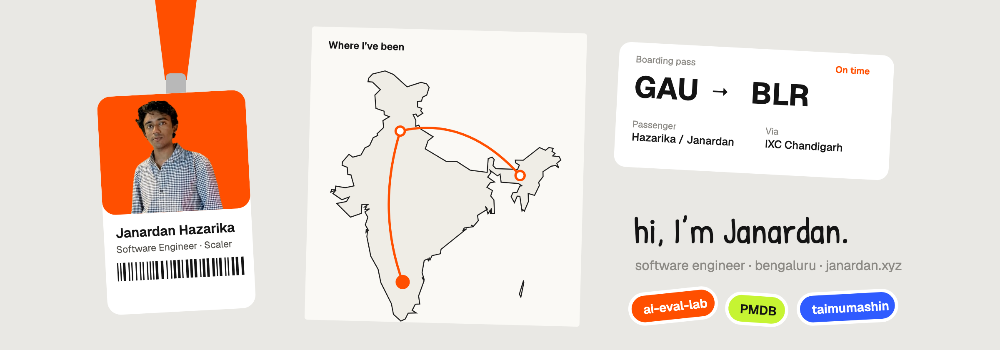

<a href="https://janardan.xyz">
  <picture>
    <source media="(prefers-color-scheme: dark)" srcset="./assets/banner-dark.png">
    
  </picture>
</a>

### Hi, I’m Janardan.

Software engineer at **Scaler** in Bengaluru. I built **[Varsity by InterviewBit](https://www.interviewbit.com/varsity)**, which runs online degrees for 6 universities including IIT Delhi and IIM Trichy, I work on Scaler’s Sales CRM and its on-call and any ad-hoc platform work.

#### Now

- **Varsity**: FastAPI, Celery, PostgreSQL, Next.js
- **Sales CRM**: Rails, GraphQL, OpenSearch, Kafka/Debezium
- **AWS in Terraform**: ECS, RDS, CloudFront, SigNoz, PagerDuty

#### After hours

- [PMDB](https://pmdb.janardan.xyz), a diary of your world of cinema
- [ai-eval-lab](https://github.com/janardannn/ai-eval-lab), exams inside real KiCad with a voice AI examiner
- [taimumashin](https://github.com/janardannn/taimumashin), cold storage on your own AWS

[janardan.xyz](https://janardan.xyz) · [LinkedIn](https://www.linkedin.com/in/janardan-hazarika-7b3b7b189/) · [X](https://x.com/janardan_ai) · [Email](mailto:janardanhazarika20@gmail.com)
